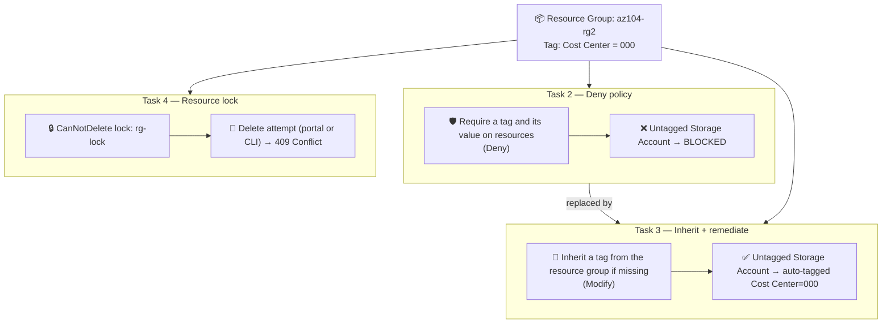

# 📋 Azure Governance at Scale — Policy Enforcement, Auto-Remediation & Resource Locks


A hands-on Azure Governance project: enforce a tagging standard with **Azure Policy**, automatically **remediate** resources that don't comply, and lock the whole thing down with **resource locks** — with every control actually tested against a real deployment attempt, not just configured.

---

## 📌 The scenario

> An organization's cloud footprint grew fast. A governance audit found a large number of resources with **no owner, project, or cost center**. The fix: enforce tagging going forward, auto-fix what's missing, and protect the governance setup itself from accidental deletion.

---

## 🏗️ Architecture



---

## 🧩 What was built & tested — 4 tasks

### Task 1 — Assign tags via the Azure portal
Created resource group `az104-rg2` (East US) and tagged it `Cost Center: 000` — the baseline every other control builds on.

### Task 2 — Enforce tagging via Azure Policy (Deny)
Assigned the built-in **"Require a tag and its value on resources"** policy, parameterized for `Cost Center = 000`, scoped to the resource group.

**Tested it:** tried creating a storage account with no tag →
```
Resource 'kapsistorage' was disallowed by policy.
(Code: RequestDisallowedByPolicy, Policy(s): Require Cost Center tag and its value on resources)
```
✅ Enforcement confirmed.

### Task 3 — Apply tagging via Azure Policy (Modify + remediation)
Deny-forever doesn't scale — it would block legitimate work indefinitely. Replaced the deny assignment with the built-in **"Inherit a tag from the resource group if missing"** policy (Modify effect, backed by a system-assigned managed identity), plus a remediation task for existing resources.

**Tested it:** created the same storage account with no tag →
- Deployment **succeeded**
- Its Tags blade showed `Cost Center: 000`, **inherited automatically**

✅ Auto-remediation confirmed.

### Task 4 — Configure and test resource locks
Added a `CanNotDelete` lock (`rg-lock`) to the resource group.

**Tested it two ways:**
1. Delete via the **Azure Portal** → blocked: *"The resource group az104-rg2 is locked and can't be deleted."*
2. Delete via **`Remove-AzResourceGroup`** in PowerShell → blocked: `StatusCode: 409, ReasonPhrase: Conflict`

✅ Confirmed the lock holds regardless of which tool is used to attempt deletion.

---

## 📁 Repository Structure

```
azure-governance-policy-lab/
├── README.md
├── .gitignore
├── policies/
│   ├── deny-missing-tag-assignment.json         # Real Task 2 assignment config
│   └── inherit-tag-remediation-assignment.json   # Real Task 3 assignment config
├── scripts/
│   ├── 01-create-resource-group.sh
│   ├── 02-assign-deny-policy.sh
│   ├── 03-test-deny-policy.sh
│   ├── 04-assign-inherit-policy.sh
│   ├── 05-test-inherit-policy.sh
│   ├── 06-add-resource-lock.sh
│   ├── 07-test-resource-lock.sh
│   └── 08-cleanup.sh / .ps1
└── docs/
    ├── architecture.md                # Design reasoning
    ├── policy-reference.md             # Built-in policy details & IDs
    ├── testing-and-verification.md      # Every test performed + results
    └── screenshots/                       # 25 real portal/CLI screenshots, in lab order
```

---

## 🚀 Try it yourself

### Prerequisites
- An Azure subscription
- [Azure CLI](https://learn.microsoft.com/cli/azure/install-azure-cli) (`az login`)

### Run the full sequence
```bash
cd scripts
chmod +x *.sh

./01-create-resource-group.sh
./02-assign-deny-policy.sh      # wait ~5-10 min for the policy to take effect
./03-test-deny-policy.sh        # expect: BLOCKED

./04-assign-inherit-policy.sh
./05-test-inherit-policy.sh     # expect: SUCCESS + auto-tagged

./06-add-resource-lock.sh
./07-test-resource-lock.sh      # expect: BLOCKED (409 Conflict)
```

### Clean up
```bash
./08-cleanup.sh
```

---

## 📸 Lab Walkthrough (real screenshots)

| # | Step | Screenshot |
|---|---|---|
| 1 | Lab introduction & scenario | `01-lab-intro.png` |
| 2 | Architecture diagram from the lab guide | `02-architecture-diagram.png` |
| 3 | Creating resource group `az104-rg2` | `03-create-resource-group.png` |
| 4 | Tag `Cost Center: 000` applied | `04-resource-group-tag-cost-center.png` |
| 5 | Browsing built-in policy definitions | `05-browse-policy-definitions.png` |
| 6 | Assigning the deny policy — scope | `06-assign-deny-policy-scope.png` |
| 7 | Assigning the deny policy — parameters | `07-assign-deny-policy-parameters.png` |
| 8 | Assigning the deny policy — review | `08-assign-deny-policy-review.png` |
| 9 | Deny policy definition details (effect, mode) | `09-deny-policy-definition-details.png` |
| 10 | Storage Accounts blade, empty | `10-storage-accounts-blade-empty.png` |
| 11 | Storage creation **blocked** by policy | `11-storage-create-blocked-by-policy.png` |
| 12 | Task 3 intro — switching to remediation | `12-task3-intro-apply-tagging.png` |
| 13 | Policy recommended assignments (Inherit tags) | `13-policy-recommended-assignments.png` |
| 14 | Assigning inherit policy + remediation task | `14-assign-inherit-policy-remediation.png` |
| 15 | Policy assignments list (both shown) | `15-policy-assignments-list.png` |
| 16 | Retrying storage creation | `16-storage-create-review-retry.png` |
| 17 | Deployment **succeeded** this time | `17-storage-deployment-succeeded.png` |
| 18 | Tag auto-inherited on the storage account | `18-tag-auto-inherited-on-storage.png` |
| 19 | Task 4 intro — resource locks | `19-task4-intro-resource-locks.png` |
| 20 | Add lock dialog (`rg-lock`, Delete) | `20-add-lock-dialog.png` |
| 21 | Lock confirmed on the resource group | `21-lock-created-rg-lock.png` |
| 22 | Attempting to delete the resource group | `22-attempt-delete-resource-group.png` |
| 23 | Delete **blocked** by lock (Portal) | `23-delete-blocked-by-lock-portal.png` |
| 24 | Cleanup attempt via PowerShell | `24-cleanup-powershell-attempt.png` |
| 25 | Delete **blocked** by lock (CLI, 409 Conflict) | `25-cleanup-blocked-by-lock-cli.png` |

*(All in `docs/screenshots/` — GitHub renders them directly.)*

---

## 🧠 What this project demonstrates
- Designing a **tagging governance strategy** aligned with the Cloud Adoption Framework
- The trade-off between **Deny** (hard block) and **Modify** (auto-heal) policy effects, and when to use each
- Azure Policy **remediation tasks** for bringing existing resources into compliance, not just new ones
- **Resource locks** as a tool-agnostic safety net enforced at the Resource Manager layer
- A test-driven approach to governance: every control was verified against a real deployment attempt, with actual error messages captured
- Full lifecycle in both **Azure CLI** and **PowerShell**

---

## 📄 License
This project is for learning purposes and documents a personal Azure training lab.
